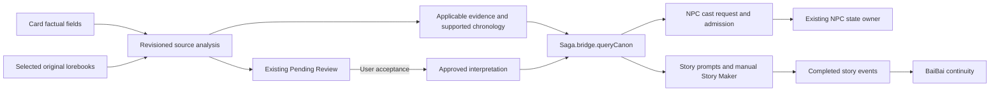

# Layer 1 trial integration

Unreleased desktop integration in the maintained [fadust/Saga fork](https://github.com/fadust/Saga), based on MentallyQuill/Saga `6c3cbcdc57e9ba20a3791597e37460356aa5a426`. Upstream history, license, decks, projects and recovery mechanisms remain intact. The companion adapter lives in [fadust/npc-codex](https://github.com/fadust/npc-codex), branch `codex/layer1-canon-adapter`.

## Ownership

Saga prepares applicable canon from factual card fields and explicitly selected original lorebooks. BaiBai owns recorded continuity, World Engine owns off-screen developments, NPC Codex owns accepted actors and their development, and the story model writes scenes. This integration adds no combat or numerical progression system and makes no direct World Engine writes.



## Enable and review

1. Select the card and chat. Select the NPC Codex scanner connection profile; Saga uses that profile for source analysis.
2. In Saga → Session → **Layer 1 — Canon sources**, select only original lorebooks and enable retrieval. Card evidence is limited to name, description, personality and scenario. Source selection is per avatar; the enable switch is global.
3. Source changes trigger analysis. **Analyze selected sources** reuses unchanged work. The summary records revision/status, changed source identities, touched entities and new proposal counts. **Review proposals** opens the existing filtered Pending Review workbench. **Show all pending proposals** removes that filter.
4. **Browse applicable evidence** exposes exact supporting passages, conditional derivations, Elevate and Mute. Review unsupported consequences before accepting them. Old-revision proposals cannot be accepted; accepted interpretations whose basis changes become stale and stop supplying evidence.
5. Story Maker and Deck Maker remain manual in both interface modes. Dedicated mobile navigation, gestures and settings were removed. Library, Lorecards, Context, Lore Timeline, tier placement and injection preview remain desktop workflows.

Generated/imported decks remain authoring material, not automatic original evidence. Automatic Saga continuity writing and continuity injection stay disabled. The secondary BunnyMo collection is a labeled manual preview only; its bundled license and pinned source identify the selected excerpts. CarrotKernel actor injection, fullsheet RAG, archives and state writes are not activated. Actor-prompt ownership remains a Layer 3 decision.

## Evidence and retrieval contract

`await Saga.bridge.queryCanon(query, { purpose: 'story' | 'identity', signal })` is read-only to consumers. Results contain `status`, `entries`, `text`, `revision`, `stage`, and, when resolved, `candidates`. Entries carry entity/type, source identity, version, revision, restrictions and exact derivation basis. Returned values are defensive copies.

Names/aliases are checked first, semantic evidence second, and connected-entity evidence third, with early exit and one three-second deadline. A missing/partial analysis, stale index, failed backend, cancellation or omitted identity evidence yields `unavailable`; ambiguous candidates yield `ambiguous`. Only a completed `no-match` permits a new NPC identity. Locations/factions/items/events cannot become character candidates. Existing dossiers are reused. Relatives mentioned only in evidence do not create dossiers.

The host generation interceptor receives pending input after swipe filtering. Canon uses existing tier extension-prompt slots and placement controls, capped at 1,000 host-tokenizer tokens in total. Whole passages are selected after deduplication. Selected native source entries are replaced by empty-outlet activation probes; the host still evaluates their restrictions, while original text cannot be injected twice. Valid card evidence remains available while book activation is pending. Cancellation and context changes clear temporary slots.

The NPC adapter places evidence in the existing cast/seeding request. It adds no per-character extraction request. Strict seed validation fills supported gaps while retaining manual locks, accepted development, terminal-death rules and existing knowledge ownership. Retrieval itself creates no story event.

## Storage and efficiency

Only rebuildable analysis, indexes and embeddings use BaiBaoKu SQLite database **saga-layer1**. Keys include source/card content revisions, analysis prompt/profile/context and embedding model/endpoint. Accepted decisions and recovery records remain in Saga files. Neither BaiBai nor NPC databases are migrated.

Unchanged source batches and document embeddings are reused; embedding batches contain at most 16 passages. Matching query/revision/context/model requests share a bounded cache. Different identity and scene queries remain separate. Summaries use records/counts without another model request. Analysis summaries, diagnostics and unaccepted proposals do not enter canon prompts. Session diagnostics distinguish request counts, estimated input tokens, provider-reported tokens when available, cache hits and retrieval latency.

## Verification, 2026-10-18

One synthetic fixture, `tests/fixtures/layer1-ari.json`, drives production model/store/runtime, Story Maker and sibling NPC adapter integration tests. Run both forks as sibling folders named `Saga` and `npc_state_delta`:

```sh
node tools/scripts/test-layer1-integration.mjs
node --experimental-vm-modules tools/scripts/test-layer1-runtime.mjs
```

Coverage includes world chronology, family ages without survival claims, mixed-version extraction, unsupported progression proposals, ambiguous aliases, dossier reuse/locks/death, proposal counts/filtering, unchanged cache reuse, source edits/deletion, duplicate UIDs, database failure, cancellation, stale results, deadlines, tier budgets and duplicate native injection. Story Maker provider input and NPC cast-prompt construction are inspected with deterministic provider responses. Existing Saga provider, Context, lifecycle, persistence, injection lifecycle, desktop smoke and Story Maker durability checks also pass. NPC's full suite, compatibility/runtime smoke, module validation, prompt measurements and packaging pass.

Actual trial checks used local EmbeddingGemma, BaiBaoKu and the host tokenizer. The final run indexed cached evidence in 14 ms; identity/name queries took 0–59 ms and the semantic healer query took 157 ms. Synthetic 768-dimensional duplicate-vector searches took 24–41 ms at 1,000 vectors and 80–133 ms at 5,000. These measure local latency, not varied-corpus recall. No Qdrant or second vector backend was added. Reproduce with `node tools/scripts/benchmark-layer1-local.mjs`; optional `SAGA_TRIAL_URL`, `SAGA_EMBEDDING_MODEL` and `SAGA_EMBEDDING_URL` select the local endpoints/model. Temporary benchmark scopes are removed afterward.

Live source analysis used the same synthetic Ari card/book through the selected NPC profile. The final run produced Ari 20, mother 44 and sibling 16, with conditional survival wording, compatible river/town facts, separate Ari Senn evidence and one unaccepted progression proposal. Repeat runs exposed model omissions and subject-assignment variability; unknown entity types, empty/missing entity evidence and missing explicit world shifts now fail closed as partial analysis. Exact quotations prove source text exists; they do not prove every model interpretation is semantically correct. Broad-corpus interpretation quality remains unverified.

The desktop pilot verifies the Session summary, filtered Pending Review, Library, Basic/Advanced modes, Context, placement controls and secondary preview. No live story generation or live NPC scan was sent; final generation/admission paths were checked with synthetic provider responses. Existing user drafts were not sent. A complete live story/NPC payload review remains a pilot check before broader use.

## Rollback and current limits

Disable the Session canon checkbox to clear temporary canon prompts and return NPC Codex to its existing path. Original card and lorebook files are never rewritten. Keep the synthetic pilot's proposals for inspection; deleting the rebuildable SQLite cache is unnecessary for rollback. The trial's original NPC adapter files have a separate backup.

The rollout remains opt-in. Analysis quality varies with the selected model; conservative partial/unavailable results defer NPC identity commitment while story generation continues. Source analysis batches are bounded between entries, so one exceptionally large source entry still needs provider capacity. Old revision cache scopes are retained for recovery/reuse; cache cleanup can follow measured storage growth. Qdrant and CarrotKernel/NPC actor ownership remain outside this rollout.
